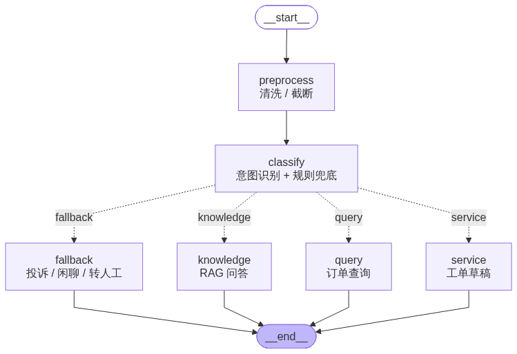
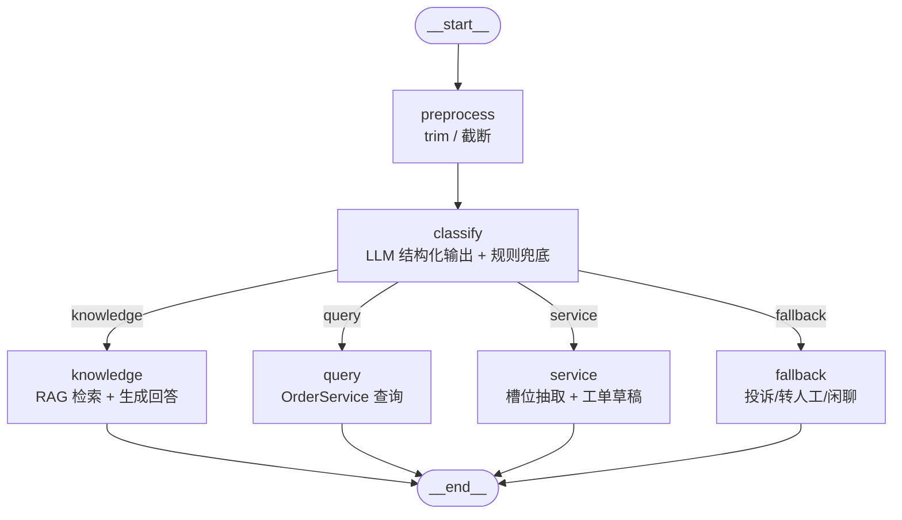

# 架构与执行路径

## 运行时真实结构（脚本生成，非手绘）



这张图是**从运行时代码里导出来的**，不是画出来的示意图——它永远和 `build_graph()` 的实际结构一致：

```powershell
python -m backend.scripts.draw_graph --png --html
```

产物：

| 文件 | 说明 |
| --- | --- |
| `docs/graph.png` | PNG 结构图。先试 mermaid.ink，失败则用本机 Chrome/Edge 离线渲染并裁掉空白（`--local` 可强制离线） |
| `docs/graph.mmd` | Mermaid 源文本，粘到支持 Mermaid 的编辑器即可看 |
| `docs/graph.html` | 单页预览（浏览器打开，按需从 CDN 加载 mermaid） |
| 终端 | ASCII 图（需要 `pip install grandalf`），内网无图形环境时最省事 |

图上会带上「agent 内部做了什么（含 RAG）」与「tools 里有哪些工具」，两处标注都是从运行时读出来的。
离线渲染截图需要 `pillow` 裁空白边框（没装就保留原始尺寸）。

在 Jupyter / IPython 里内嵌显示：

```python
from IPython.display import Image, display
from backend.application.runtime import create_runtime

graph = create_runtime().graph
display(Image(graph.get_graph().draw_mermaid_png()))   # 联网渲染
print(graph.get_graph().draw_ascii())                  # 离线看结构
```

内网环境想让 PNG 完全离线渲染，装 `pyppeteer` 后把 `draw_method` 换成 `MermaidDrawMethod.PYPPETEER`；或者干脆用 `graph.mmd`。

## 图内节点与边

只画 LangGraph 图里的节点与边，不掺业务组件（前端、FastAPI、知识库、存储的位置见下面「分层与职责」表）：



| 元素 | 说明 |
| --- | --- |
| `preprocess` | 取最后一条用户消息，去空白并截断到 2000 字 |
| `classify` | `classify_intent()`：优先 LLM `with_structured_output`，演示模式/失败时用 `rule_classify()`；产出 intent/confidence/reason/slots |
| `route_by_intent` | 条件边：只允许 knowledge / query / service / fallback，未知意图走 fallback |
| `knowledge` | 调用检索器并拼【参考资料】，再 `llm.invoke()` 生成带引用回答 |
| `query` | 解析订单号/关键词，调用 `OrderService.get/search`，返回订单列表（不检索） |
| `service` | 抽取业务类型/订单号/联系人等槽位，生成可编辑草稿；用户确认后才提交 |
| `fallback` | 投诉/转人工/闲聊兜底话术；演示版无人工坐席 |

当前 LangGraph 里**不再有 `agent` / `tools` 节点**：订单分支直接调用用例，工单工具仍保留在
`application/agent/tools.py` 与单测中，但运行时不暴露。

## 工具是什么

工具就是**普通 Python 函数**，只是用 `@tool` 装饰并声明了参数 schema：模型在对话里决定调不调、调哪个，
LangGraph 的 `ToolNode` 负责执行，返回值作为一条 `ToolMessage` 回到模型。三个工具都在
`backend/application/agent/tools.py`，由 `create_tools(tickets)` 按工单用例创建。

| 工具 | 作用 | 关键参数 | 什么时候会被调用 | 返回 |
| --- | --- | --- | --- | --- |
| `create_ticket` | 创建售后工单 | `title` / `description` / `category`（7 类电商分类）/ `priority`（4 档枚举）/ `contact` | 帮助中心解决不了、或用户明确要求建单 | `{ok, duplicated, ticket}` |
| `query_ticket` | 查进度、催单 | `ticket_id` / `contact` / `urge` | 用户问「处理到哪了」「催一下」「我的工单」 | `{ok, tickets[], message}` |
| `escalate_to_human` | 转人工 | `ticket_id` / `reason` | 用户要求转人工、或超出能力范围 | `{ok, ticket}` |
| `query_order` | 查订单 | `order_no` / `keyword`（姓名/手机号/商品）/ `status` | 用户问「我的订单/订单进度/订单号」，命中 `order_lookup` 意图 | `{ok, orders[], message}` |

> 当前运行时只向 Agent 暴露 `query_order`（`create_tools(..., include_tickets=False)`）；
> 三个工单工具保留在代码与单测里，供后续产品需要时恢复。

三个工具共同的设计：

- **参数用 Pydantic 约束**：分类与优先级是 `Literal` 枚举，会变成工具参数 JSON Schema 里的 `enum`，模型编不出「服务器坏了」这种值；
- **校验失败交给模型自纠**：不合法参数抛 `ValidationError`，`ToolNode` 默认把错误转成 `ToolMessage` 回给模型让它改参数重试，而不是整轮失败；
- **返回值统一是 JSON 字符串**：模型读得懂，`runtime.py` 也能解析出工单号推给前端；`ok=False` 时由模型组织成人话，不把原始 JSON 念给用户；
- **写操作有幂等兜底**：同一联系人 + 同标题 + 未关闭的重复建单，存储层直接返回已有工单。

订单查询是**只读工具**：`order_lookup` 意图会跳过 RAG（避免把「订单」当成知识问题），
直接调用 `query_order` 查 `OrderService`；查不到时让用户补订单号，不创建售后工单。

## 分层与职责

目录是四层（都在 `backend/` 下），对外常讲成五层——因为「表现层」是独立的 `frontend/`：

| 五层说法 | 目录 | 职责 | 换实现的代价 |
| --- | --- | --- | --- |
| 表现层 | `frontend/src/*` | 对话界面、工单面板、SSE 客户端 | 只改 `api/agent.ts` |
| 接口层 | `backend/api/` | `app.py` 组装、`routes/`（dialogue / system / chat / agent）、`schemas.py`（DTO 与 SSE 编码） | 不改 |
| 接口层（数据接口） | `backend/api/routes/knowledge.py`、`orders.py`、`metrics.py` | 知识库检索/目录、订单查询、运营指标 | 不改 |
| 应用层 | `backend/application/` | `runtime.py` 装配；`agent/`（graph / tools / prompts）；`chat/service.py`（一轮对话）；`tickets/service.py`（售后工单）；`orders/service.py`（订单查询）；`knowledge/service.py`（知识库目录） | 加用例不改图 |
| 领域层 | `backend/domain/` | `models.py` 实体、`rules.py` 枚举与状态流转/去重规则、`errors.py` 领域异常 | 不改 |
| 基础设施层 | `backend/infrastructure/` | `config.py`、`logging.py`、`llm/`、`memory/`、`retrieval/`、`persistence/`、`observability/`（指标）、`version.py`（git 版本） | 只加一个分支 |

依赖方向单向：`api → application → domain`，`infrastructure` 由 `application` 在装配时注入。
领域层不 import FastAPI / LangChain；接口层不写业务规则。

对话接口在装配上采用中立聚合 Router：

```text
main app
└── dialogue aggregator
    ├── chat router
    │   └── POST /chat
    └── branch router
        ├── POST /branch/knowledge
        ├── POST /branch/query
        ├── POST /branch/service
        ├── POST /branch/service/confirm
        └── POST /branch/fallback
```

`app.py` 只挂载 dialogue 聚合 router；chat 与 branch 在聚合层平级挂载，避免让
`/chat` 反向依赖 `/branch`。FastAPI 对外仍将六条对话路径扁平化为独立接口，因此 URL
和行为不变。

前端页面：`#/`（首页对话框）、`#/chat`（会话记录）、`?panel=knowledge`（知识库结果）、
`?panel=orders`（本轮订单）、`?panel=service`（业务办理）、`#/orders`、`#/kb`、`#/admin`。前端结构：`pages/`（页面）→
`components/`（可复用块）→ `hooks/`（状态）→ `api/`（网络），会话历史存 localStorage。

电商业务入口另有两个独立页面：`#/orders`（订单查询，50 条演示订单）与 `#/kb`
（知识库检索，50 篇 HTML + 8 个分类）。数据在 `backend/data/demo/ecommerce/`，
订单字段按 Postgres 表形状组织，知识库正文是可直接打开的 HTML。

## 一轮对话的执行路径

1. 前端 `streamChat()` 发 `POST /chat`，带 `message` 与 `thread_id`；
2. `ChatService.stream()` 以 `stream_mode=["messages", "custom", "updates"]` 订阅图；
3. `preprocess` 清理问题，`classify` 执行 LLM 结构化意图识别，失败时退回规则；
4. `route_by_intent` 只会进入 knowledge / query / service / fallback 之一；
5. `/branch/{intent}` 是四个显式 HTTP 入口，会锁定对应分支并跳过再次分类；
6. 过程中向前端推事件：

| 事件 | 时机 | 载荷 |
| --- | --- | --- |
| `start` | 收到请求 | `thread_id` / `provider` / `mock` |
| `intent` | 意图识别完成 | `intent` / `confidence` / `reason` / `slots` |
| `token` | 模型流式增量 | `text` |
| `order` | 订单查询完成 | `orders[]` |
| `service_draft` | 业务草稿生成 | 槽位、缺失项、ready、`requires_confirmation` |
| `tool` | 工具被调用 / 返回 | `phase=call\|result`、`name`、`ok`、`message` |
| `ticket` | 工具产出工单 | `tickets[]`（完整工单） |
| `citation` | 本轮检索命中 | `index` / `source` / `title` / `snippet` / `score` |
| `done` / `error` | 一轮结束 | —— |

7. `MemorySaver` 按 `thread_id` 保存状态，多轮对话不丢上下文；
8. 前端把 `order` / `citation` / `service_draft` 渲染成气泡底部标签，并切换右侧对应面板；
9. 业务草稿阶段不写库；用户核对并确认后才调用 `/branch/service/confirm` 创建工单；
10. `ticket` 与 `tool` 事件名仍保留在契约中，但当前对话分支不会产生。

SSE 响应由 FastAPI 内置的 `EventSourceResponse + ServerSentEvent` 编码；
路由函数以异步生成器产出 `ServerSentEvent`，并通过 `response_class=EventSourceResponse`
交给 FastAPI 路由层编码；`ServerSentEvent.data` 直接接收 JSON 可序列化对象，不再由项目
手写 `event:/data:` 文本。

`stream_events()` 在生成器内完成 payload JSON 序列化。上游异常或序列化失败会记录日志，
并转成单个终止性 `error` 事件；`CancelledError` 属于 `BaseException`，客户端主动断开
不会被误转而中止流。

当前 `langgraph-native` 分支中，业务节点通过官方 `StreamWriter` 直接写入 custom 流：

```text
classify      → intent
query         → order
knowledge     → citation
service       → service_draft
```

ChatService 不再从 updates 中反推这些业务事件。状态仍写回 LangGraph checkpoint；
custom 事件只负责实时输出。对应的 `sse-abstract` 分支保留了“从 updates 映射事件”的实现，
便于对比两种写法。

## 四个扩展点与生产替换

| 扩展点 | POC 实现 | 抽象接口 | 生产替换 | 怎么换 |
| --- | --- | --- | --- | --- |
| 模型 | `ChatOpenAI` 直连 DeepSeek / mock | `BaseChatModel` | LiteLLM 网关 / vLLM | `infrastructure/llm/factory.py` 加分支 |
| 记忆 | `InMemorySaver`（进程内存） | `BaseCheckpointSaver` | `PostgresSaver` | `.env: CHECKPOINTER=postgres` |
| 检索 | 关键词 IDF 打分 | `BaseRetriever` | pgvector + 混合检索 + 重排 | `.env: RETRIEVER=pgvector` |
| 工单存储 | JSON 文件 | 同名方法 | Postgres 工单表 | `.env: TICKET_STORE=postgres` |
| 前端 API | `streamChat()` fetch + SSE | `api/agent.ts` | useStream / WebSocket | 只改这一个文件 |
| 编排 | preprocess + classify + 四路分支 + custom 事件 | LangGraph StateGraph | Planner/Executor/Validator/Summarizer | 加节点与条件边，现有节点不动 |

## 几个刻意的设计取舍

- **胶水层薄**：FastAPI 只做 HTTP/SSE 适配，编排全在 LangGraph，同一张图可以搬到 CLI、定时任务或消息网关。
- **查询与写入分离**：检索只读知识库，工具只写工单存储，互不碰对方的数据结构。
- **参考资料不进消息历史**：每轮临时拼进系统提示，多轮对话不会被旧资料撑爆上下文。
- **事件名即契约**：前端按事件名分发；业务草稿通过新增 `service_draft` 扩展，不改变既有事件形状。
