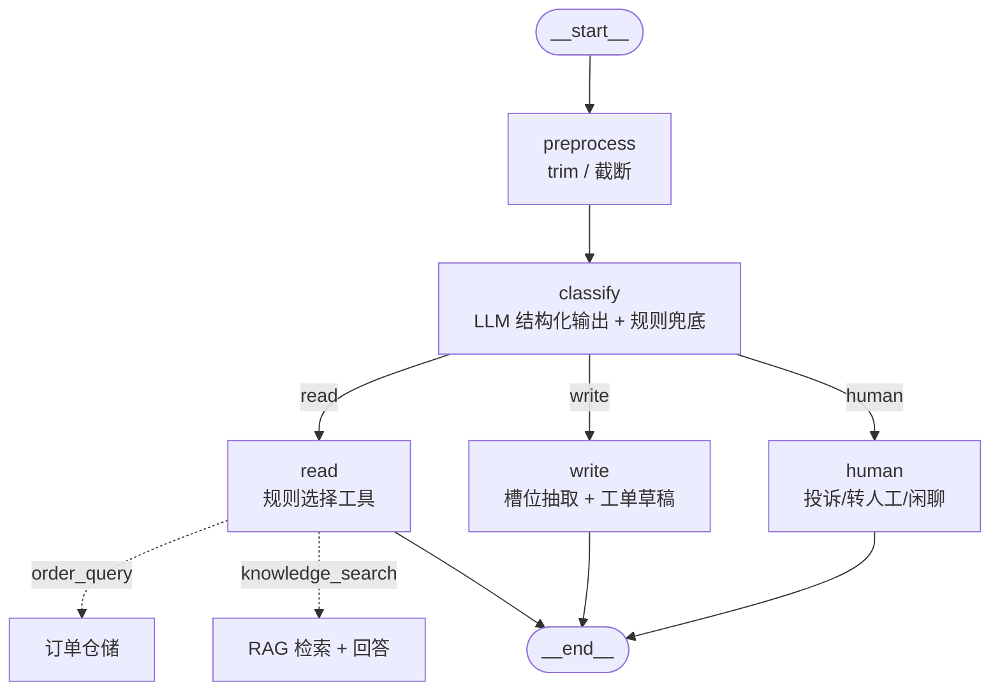

# 架构与执行路径

## 运行时真实结构（脚本生成，非手绘）


这张图是**从运行时代码里导出来的**，不是画出来的示意图——它永远和 `build_graph()` 的实际结构一致：

```powershell
python -m backend.scripts.draw_graph --png --html
```

产物：

| 文件 | 说明 |
| --- | --- |
| `docs/graph.png` | PNG 结构图。先试 mermaid.ink，失败则用本机 Chrome/Edge 离线渲染并裁掉空白（`--local` 可强制离线） |
| `docs/graph.mmd` | Mermaid 源文本，粘到支持 Mermaid 的编辑器即可看 |
| `docs/graph.html` | 单页预览（浏览器打开，按需从 CDN 加载 mermaid） |
| 终端 | ASCII 图（需要 `pip install grandalf`），内网无图形环境时最省事 |

图上的节点和条件边标注由运行时结构生成。
离线渲染截图需要 `pillow` 裁空白边框（没装就保留原始尺寸）。

在 Jupyter / IPython 里内嵌显示：

```python
from IPython.display import Image, display
from backend.application.runtime import create_runtime

graph = create_runtime().graph
display(Image(graph.get_graph().draw_mermaid_png()))   # 联网渲染
print(graph.get_graph().draw_ascii())                  # 离线看结构
```

内网环境想让 PNG 完全离线渲染，装 `pyppeteer` 后把 `draw_method` 换成 `MermaidDrawMethod.PYPPETEER`；或者干脆用 `graph.mmd`。

## 图内节点与边

只画 LangGraph 图里的节点与边，不掺业务组件（前端、FastAPI、知识库、存储的位置见下面「分层与职责」表）：



| 元素 | 说明 |
| --- | --- |
| `preprocess` | 取最后一条用户消息，去空白并截断到 2000 字 |
| `classify` | `classify_intent()`：优先 LLM `with_structured_output`，演示模式/失败时用 `rule_classify()`；产出 intent/confidence/reason/slots |
| `route_by_intent` | 条件边：只允许 read / write / human，未知意图走 human |
| `read` | 按 `is_order_query()` 确定性选择 `order_query` 或 `knowledge_search` 工具 |
| `order_query` | 解析订单号/关键词，调用 `JsonOrderStore.get/search`，返回订单列表 |
| `knowledge_search` | 调用检索器并拼【参考资料】，再 `llm.invoke()` 生成带引用回答 |
| `write` | 抽取业务类型/订单号/联系人等槽位，生成可编辑草稿；用户确认后才提交 |
| `human` | 投诉/转人工/闲聊兜底话术；演示版无人工坐席 |

read、write、human 三类都是明确、可测试的执行路径；read 内部工具选择完全由规则决定。

## Agent 与工具边界

当前 POC 不向模型暴露工具。read 节点按规则调用订单查询或知识库工具；售后业务只生成
草稿，用户确认后才通过独立的 `service-actions` 路由创建工单。

订单查询是 `read` 分支下的**确定性只读工具**：精确订单号或显式 user_id 会跳过 RAG，
直接调用 `JsonOrderStore`；查不到时让用户补订单号，不创建售后工单。

## 分层与职责

目录是四层（都在 `backend/` 下），对外常讲成五层——因为「表现层」是独立的 `frontend/`：

| 五层说法 | 目录 | 职责 | 换实现的代价 |
| --- | --- | --- | --- |
| 表现层 | `frontend/src/*` | 对话界面、工单面板、SSE 客户端 | 只改 `api/agent.ts` |
| 接口层 | `backend/api/` | `core.py` 集中请求模型、全部路由、SSE、FastAPI 与静态托管；`app.py` 是 ASGI 入口 | 不改 |
| 应用层 | `backend/application/` | `graph.py` 三路编排与工具，`chat.py` 对话用例，`runtime.py` 运行装配 | 按职责修改对应文件 |
| 领域层 | `backend/domain/` | `intent.py` 意图/槽位/分类，`models.py` 实体、订单摘要和工单规则 | 按领域修改对应文件 |
| 基础设施层 | `backend/infrastructure/` | 配置、仓储、检索、模型、指标与 Langfuse 分文件维护 | 按适配器扩展 |

依赖方向单向：`api → application → domain`，`infrastructure` 由 `application` 在装配时注入。
领域层不 import FastAPI / LangChain；接口层不写业务规则。

全部接口由一个 Router 注册：

```text
main app
└── api/routes.py router
    ├── POST /chat
    ├── POST /branch/service/confirm
    └── POST /api/llm/config
```

`app.py` 负责应用组装和生命周期，`routes.py` 负责 HTTP/SSE 路由。`/chat` 是唯一
对话入口；`/branch/service/confirm` 是用户确认后的业务写操作，标记为 `service-actions`。

模型 API Key 通过前端右下角设置窗口提交到 `/api/llm/config`。后端先创建模型并发起最小
验证调用，成功后重建 LangGraph；Key 只存在于当前进程内存，不写入 `.env`、浏览器存储或日志。
该模式是单实例 POC 配置，多用户生产环境应改为用户级密钥托管或服务端集中网关。

`reconfigure_llm()` 会在锁内重新编译 LangGraph，并原子替换整组 `graph/llm/provider/model`。
每轮请求通过 `snapshot()` 固定本轮使用的图；切换发生后，新请求使用新图，已开始的流继续使用旧图。

运营概览同时读取 `/api/evaluation/summary`，对 `eval_cases.json` 中 40 条固定样本计算规则
意图准确率、read 工具准确率和 RAG Top-3 来源命中率，并列出未通过用例。该评测不调用真实模型，
因此不会因刷新后台产生额外 Token 费用；真实 LLM 对照评测属于后续扩展。

前端页面：`#/`（首页对话框）、`#/chat`（会话记录）、`?panel=knowledge`（知识库结果）、
`?panel=orders`（本轮订单）、`?panel=service`（业务办理）、`#/orders`、`#/kb`、`#/admin`。前端结构：`pages/`（页面）→
`components/`（可复用块）→ `hooks/`（状态）→ `api/`（网络），会话历史存 localStorage。

电商业务入口另有两个独立页面：`#/orders`（订单查询，50 条演示订单）与 `#/kb`
（知识库检索，50 篇 HTML + 8 个分类）。数据在 `backend/data/demo/ecommerce/`，
订单字段按 Postgres 表形状组织，知识库正文是可直接打开的 HTML。

## 一轮对话的执行路径

1. 前端 `streamChat()` 发 `POST /chat`，带 `message` 与 `thread_id`；
2. `ChatService.stream()` 以 `stream_mode=["messages", "custom", "updates"]` 订阅图；
3. `preprocess` 清理问题，`classify` 执行 LLM 结构化意图识别，失败时退回规则；
4. `route_by_intent` 只会进入 read / write / human 之一；
5. `read` 按规则选择 `order_query` 或 `knowledge_search`，不进行第二次模型调用；
6. 过程中向前端推事件：

Langfuse 启用时，ChatService 会把 `CallbackHandler` 注入 LangGraph 调用配置，并将
`thread_id` 作为 `langfuse_session_id`；未启用或初始化失败时不注入 callback，主链路继续运行。

| 事件 | 时机 | 载荷 |
| --- | --- | --- |
| `start` | 收到请求 | `thread_id` / `provider` / `mock` |
| `intent` | 意图识别完成 | `intent` / `confidence` / `reason` / `slots` |
| `token` | 模型流式增量 | `text` |
| `order` | 订单查询完成 | `orders[]` |
| `service_draft` | 业务草稿生成 | 槽位、缺失项、ready、`requires_confirmation` |
| `citation` | 本轮检索命中 | `index` / `source` / `title` / `snippet` / `score` |
| `done` / `error` | 一轮结束 | —— |

7. `MemorySaver` 按 `thread_id` 保存状态，多轮对话不丢上下文；
8. 前端把 `order` / `citation` / `service_draft` 渲染成气泡底部标签，并切换右侧对应面板；
9. 业务草稿阶段不写库；用户核对并确认后才调用 `/branch/service/confirm` 创建工单；
10. 对话事件契约不包含工单写入；工单只在 service-actions 的 JSON 响应中返回。

SSE 响应由 FastAPI 内置的 `EventSourceResponse + ServerSentEvent` 编码；
路由函数以异步生成器产出 `ServerSentEvent`，并通过 `response_class=EventSourceResponse`
交给 FastAPI 路由层编码；`ServerSentEvent.data` 直接接收 JSON 可序列化对象，不再由项目
手写 `event:/data:` 文本。

`stream_events()` 在生成器内完成 payload JSON 序列化。上游异常或序列化失败会记录日志，
并转成单个终止性 `error` 事件；`CancelledError` 属于 `BaseException`，客户端主动断开
不会被误转而中止流。

当前 `langgraph-native` 分支中，业务节点通过官方 `StreamWriter` 直接写入 custom 流：

```text
classify      → intent
read/order_query      → order
read/knowledge_search → citation
write                 → service_draft
```

ChatService 不再从 updates 中反推这些业务事件。状态仍写回 LangGraph checkpoint；
custom 事件只负责实时输出。对应的 `sse-abstract` 分支保留了“从 updates 映射事件”的实现，
便于对比两种写法。

`EVENT_*` 属于跨 Agent、Chat、API 与 CLI 的共享契约，统一放在
`application/graph.py`。Chat、Agent 与 API 直接引用同一组常量，不再维护包门面。

## 四个扩展点与生产替换

| 扩展点 | POC 实现 | 抽象接口 | 生产替换 | 怎么换 |
| --- | --- | --- | --- | --- |
| 模型 | `ChatOpenAI` 直连 DeepSeek / mock | `BaseChatModel` | LiteLLM 网关 / vLLM | `infrastructure/llm.py` 的 `create_llm()` 加分支 |
| 记忆 | `InMemorySaver`（进程内存） | `BaseCheckpointSaver` | `PostgresSaver` | `.env: CHECKPOINTER=postgres` |
| 检索 | 关键词命中 + 标题加权 | `BaseRetriever` | pgvector + 混合检索 + 重排 | `.env: RETRIEVER=pgvector` |
| 工单存储 | JSON 文件 | 同名方法 | Postgres 工单表 | `.env: TICKET_STORE=postgres` |
| LLM 可观测性 | 可选 Langfuse CallbackHandler | LangChain callbacks | Langfuse Cloud / 自托管 | `.env: LANGFUSE_ENABLED=true` |

进程内指标只保留 KPI 和最终意图聚合 `calls / tokens / avg_latency_ms / success_rate`，
用于后续按知识问答、订单、业务办理和兜底分支分别优化。
每次请求创建独立 `UsageMetadataCallbackHandler`，按模型累加本轮全部 LLM 调用 Token；
没有真实 usage 的 Mock 或异常场景回退到本地估算。
| 前端 API | `streamChat()` fetch + SSE | `api/agent.ts` | useStream / WebSocket | 只改这一个文件 |
| 编排 | preprocess + classify + 三类分支 | LangGraph StateGraph | Planner/Executor/Validator/Summarizer | 加节点与条件边，现有节点不动 |

## 几个刻意的设计取舍

- **胶水层薄**：FastAPI 只做 HTTP/SSE 适配，编排全在 LangGraph，同一张图可以搬到 CLI、定时任务或消息网关。
- **查询与写入分离**：检索只读知识库，工具只写工单存储，互不碰对方的数据结构。
- **参考资料不进消息历史**：每轮临时拼进系统提示，多轮对话不会被旧资料撑爆上下文。
- **事件名即契约**：前端按事件名分发；业务草稿通过新增 `service_draft` 扩展，不改变既有事件形状。
