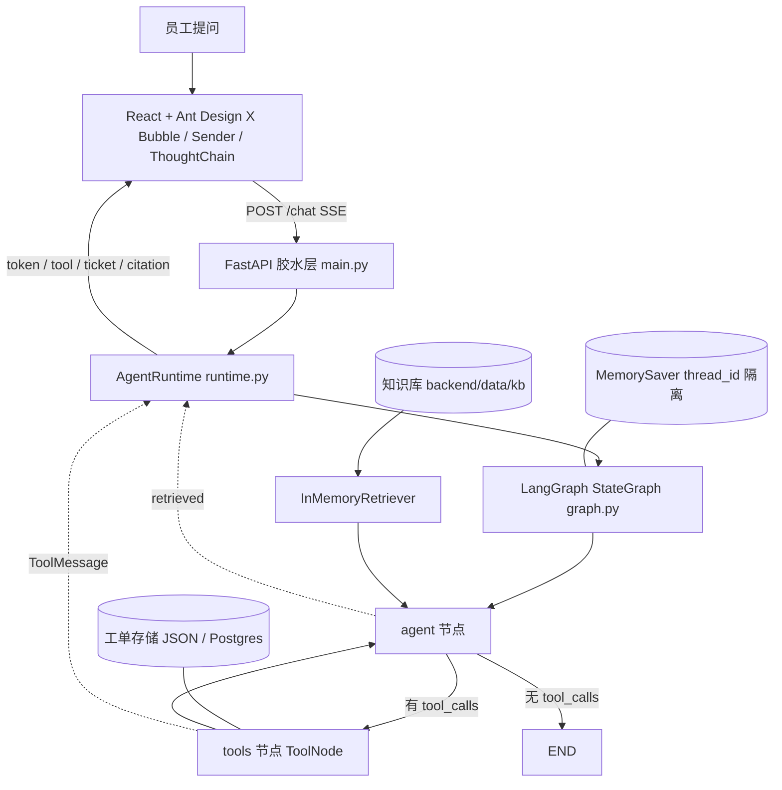

# 架构与执行路径

## 运行时真实结构（脚本生成，非手绘）


这张图是**从运行时代码里导出来的**，不是画出来的示意图——它永远和 `build_graph()` 的实际结构一致：

```powershell
python -m backend.scripts.draw_graph --png --html --both-variants
```

产物：

| 文件 | 说明 |
| --- | --- |
| `docs/graph.png` | PNG 结构图（默认走 mermaid.ink 渲染，需要联网） |
| `docs/graph.mmd` | Mermaid 源文本，粘到支持 Mermaid 的编辑器即可看 |
| `docs/graph-minimal.mmd` | 对照用的最小图（无工具、无检索，退化成 Agent → END） |
| `docs/graph.html` | 单页预览（浏览器打开，按需从 CDN 加载 mermaid） |
| 终端 | ASCII 图（需要 `pip install grandalf`），内网无图形环境时最省事 |

在 Jupyter / IPython 里内嵌显示：

```python
from IPython.display import Image, display
from backend.runtime import create_runtime

graph = create_runtime().graph
display(Image(graph.get_graph().draw_mermaid_png()))   # 联网渲染
print(graph.get_graph().draw_ascii())                  # 离线看结构
```

内网环境想让 PNG 完全离线渲染，装 `pyppeteer` 后把 `draw_method` 换成 `MermaidDrawMethod.PYPPETEER`；或者干脆用 `graph.mmd`。

## 整体结构



## 分层与职责

| 层 | 文件 | 职责 | 换实现的代价 |
| --- | --- | --- | --- |
| 配置 | `backend/config.py` | 所有开关集中在这里，业务代码不读环境变量 | 无 |
| 工厂 | `backend/factories/*` | 按配置创建 LLM / 记忆 / 检索 / 工单存储 | 只加一个分支 |
| 编排 | `backend/graph.py` | 状态、节点、条件边、检索注入、系统提示词 | 不改 |
| 工具 | `backend/tools.py` | 三个 `@tool`，参数走 Pydantic 校验 | 不改 |
| 存储 | `backend/stores/json_store.py` | 工单落盘、时间线、重复建单拦截 | 新写一个实现 |
| 检索 | `backend/retrievers/memory.py` | 切块、打分、拼参考资料 | 新写一个实现 |
| 装配 | `backend/runtime.py` | 拼装组件 + 唯一流式出口 | 只改这一个文件 |
| 接口 | `backend/main.py` | HTTP/SSE、工单接口、可选同源托管前端 | 不改 |
| 前端 | `frontend/src/*` | 对话界面、工单面板、SSE 客户端 | 只改 `api/agent.ts` |

## 一轮对话的执行路径

1. 前端 `streamChat()` 发 `POST /chat`，带 `message` 与 `thread_id`；
2. `runtime.stream()` 以 `stream_mode=["messages", "updates"]` 订阅图；
3. `agent` 节点：用最后一条用户消息检索知识库，命中则把 `【参考资料】` 拼进系统提示，再 `llm.bind_tools(tools).invoke()`；
4. 条件边判断：有 `tool_calls` 就走 `tools` 节点执行，回到 `agent` 重新总结；没有就 `END`；
5. 过程中向前端推事件：

| 事件 | 时机 | 载荷 |
| --- | --- | --- |
| `start` | 收到请求 | `thread_id` / `provider` / `mock` |
| `token` | 模型流式增量 | `text` |
| `tool` | 工具被调用 / 返回 | `phase=call\|result`、`name`、`ok`、`message` |
| `ticket` | 工具产出工单 | `tickets[]`（完整工单） |
| `citation` | 本轮检索命中 | `index` / `source` / `title` / `snippet` / `score` |
| `done` / `error` | 一轮结束 | —— |

6. `MemorySaver` 按 `thread_id` 保存状态，多轮对话不丢上下文；
7. 前端把 `tool` 事件渲染成 ThoughtChain，把 `ticket` / `citation` 渲染成气泡底部的工单标签与引用；
8. 工单有变化时前端重新拉 `/api/tickets` 刷新右侧看板。

## 四个扩展点与生产替换

| 扩展点 | POC 实现 | 抽象接口 | 生产替换 | 怎么换 |
| --- | --- | --- | --- | --- |
| 模型 | `ChatOpenAI` 直连 DeepSeek / mock | `BaseChatModel` | LiteLLM 网关 / vLLM | `factories/llm.py` 加分支 |
| 记忆 | `InMemorySaver`（进程内存） | `BaseCheckpointSaver` | `PostgresSaver` | `.env: CHECKPOINTER=postgres` |
| 检索 | 关键词 IDF 打分 | `BaseRetriever` | pgvector + 混合检索 + 重排 | `.env: RETRIEVER=pgvector` |
| 工单存储 | JSON 文件 | 同名方法 | Postgres 工单表 | `.env: TICKET_STORE=postgres` |
| 前端 API | `streamChat()` fetch + SSE | `api/agent.ts` | useStream / WebSocket | 只改这一个文件 |
| 编排 | Agent + Tool 两节点 | LangGraph StateGraph | Planner/Executor/Validator/Summarizer | 加节点与条件边，现有节点不动 |

## 几个刻意的设计取舍

- **胶水层薄**：FastAPI 只做 HTTP/SSE 适配，编排全在 LangGraph，同一张图可以搬到 CLI、定时任务或消息网关。
- **查询与写入分离**：检索只读知识库，工具只写工单存储，互不碰对方的数据结构。
- **参考资料不进消息历史**：每轮临时拼进系统提示，多轮对话不会被旧资料撑爆上下文。
- **事件名即契约**：SSE 事件名固定 7 类，前端按名字分发，加能力只加事件不加接口。
