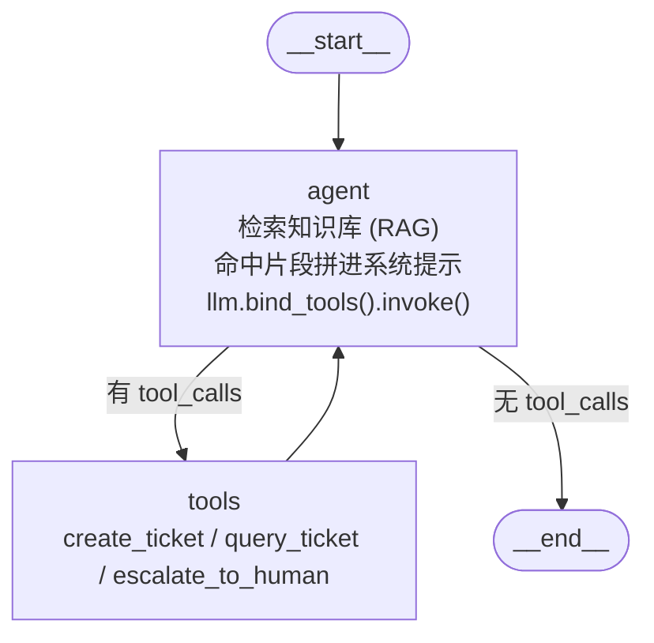

# 架构与执行路径

## 运行时真实结构（脚本生成，非手绘）


这张图是**从运行时代码里导出来的**，不是画出来的示意图——它永远和 `build_graph()` 的实际结构一致：

```powershell
python -m backend.scripts.draw_graph --png --html --both-variants
```

产物：

| 文件 | 说明 |
| --- | --- |
| `docs/graph.png` | PNG 结构图。先试 mermaid.ink，失败则用本机 Chrome/Edge 离线渲染并裁掉空白（`--local` 可强制离线） |
| `docs/graph.mmd` | Mermaid 源文本，粘到支持 Mermaid 的编辑器即可看 |
| `docs/graph-minimal.mmd` | 对照用的最小图（无工具、无检索，退化成 Agent → END） |
| `docs/graph.html` | 单页预览（浏览器打开，按需从 CDN 加载 mermaid） |
| 终端 | ASCII 图（需要 `pip install grandalf`），内网无图形环境时最省事 |

图上会带上「agent 内部做了什么（含 RAG）」与「tools 里有哪些工具」，两处标注都是从运行时读出来的。
离线渲染截图需要 `pillow` 裁空白边框（没装就保留原始尺寸）。

在 Jupyter / IPython 里内嵌显示：

```python
from IPython.display import Image, display
from backend.application.runtime import create_runtime

graph = create_runtime().graph
display(Image(graph.get_graph().draw_mermaid_png()))   # 联网渲染
print(graph.get_graph().draw_ascii())                  # 离线看结构
```

内网环境想让 PNG 完全离线渲染，装 `pyppeteer` 后把 `draw_method` 换成 `MermaidDrawMethod.PYPPETEER`；或者干脆用 `graph.mmd`。

## 图内节点与边

只画 LangGraph 图里的节点与边，不掺业务组件（前端、FastAPI、知识库、存储的位置见下面「分层与职责」表）：



| 元素 | 谁定义的 | 说明 |
| --- | --- | --- |
| `__start__` / `__end__` | LangGraph 内置 | 入口与出口，编译时自动注入 |
| `agent` | 本项目（`graph.py`） | 四步：取用户消息 → **检索知识库（RAG）** → 命中片段拼进系统提示 → `llm.bind_tools().invoke()`；产出 `tool_calls` 或最终回答 |
| `tools` | `langgraph.prebuilt.ToolNode` | 执行工具并把结果作为 `ToolMessage` 写回状态。里面装的正是下面三个工具 |
| `agent → tools` / `agent → __end__` | 本项目（`route_after_agent`） | 同一条条件边：有 `tool_calls` 走工具，否则结束 |
| `tools → agent` | 本项目 | 固定回边，工具执行完回到模型重新总结 |

没有工具可用时（阶段一的空工具表），`tools` 节点与条件边都不注册，图退化成 `__start__ → agent → __end__`，
对照见 `docs/graph-minimal.mmd`。

上面的节点标注不是手写的：`draw_graph.py` 会从运行时读出「agent 是否接入检索」「tools 里注册了哪些工具」，
再写进图里，所以图和代码不会各说各话。

## 工具是什么

工具就是**普通 Python 函数**，只是用 `@tool` 装饰并声明了参数 schema：模型在对话里决定调不调、调哪个，
LangGraph 的 `ToolNode` 负责执行，返回值作为一条 `ToolMessage` 回到模型。三个工具都在
`backend/application/agent/tools.py`，由 `create_tools(tickets)` 按工单用例创建。

| 工具 | 作用 | 关键参数 | 什么时候会被调用 | 返回 |
| --- | --- | --- | --- | --- |
| `create_ticket` | 建单 | `title` / `description` / `category`（6 类枚举）/ `priority`（4 档枚举）/ `contact` | 知识库解决不了、或用户明确要求建单 | `{ok, duplicated, ticket}` |
| `query_ticket` | 查进度、催单 | `ticket_id` / `contact` / `urge` | 用户问「处理到哪了」「催一下」「我的工单」 | `{ok, tickets[], message}` |
| `escalate_to_human` | 转人工 | `ticket_id` / `reason` | 用户要求转人工、或超出能力范围 | `{ok, ticket}` |

三个工具共同的设计：

- **参数用 Pydantic 约束**：分类与优先级是 `Literal` 枚举，会变成工具参数 JSON Schema 里的 `enum`，模型编不出「服务器坏了」这种值；
- **校验失败交给模型自纠**：不合法参数抛 `ValidationError`，`ToolNode` 默认把错误转成 `ToolMessage` 回给模型让它改参数重试，而不是整轮失败；
- **返回值统一是 JSON 字符串**：模型读得懂，`runtime.py` 也能解析出工单号推给前端；`ok=False` 时由模型组织成人话，不把原始 JSON 念给用户；
- **写操作有幂等兜底**：同一联系人 + 同标题 + 未关闭的重复建单，存储层直接返回已有工单。

## 分层与职责

目录是四层（都在 `backend/` 下），对外常讲成五层——因为「表现层」是独立的 `frontend/`：

| 五层说法 | 目录 | 职责 | 换实现的代价 |
| --- | --- | --- | --- |
| 表现层 | `frontend/src/*` | 对话界面、工单面板、SSE 客户端 | 只改 `api/agent.ts` |
| 接口层 | `backend/api/` | `app.py` 组装、`routes/`（system / chat / tickets）、`schemas.py`（DTO 与 SSE 编码） | 不改 |
| 应用层 | `backend/application/` | `runtime.py` 装配；`agent/`（graph / tools / prompts）；`chat/service.py`（一轮对话用例）；`tickets/service.py`（工单用例） | 加用例不改图 |
| 领域层 | `backend/domain/` | `models.py` 实体、`rules.py` 枚举与状态流转/去重规则、`errors.py` 领域异常 | 不改 |
| 基础设施层 | `backend/infrastructure/` | `config.py`、`logging.py`、`llm/`、`memory/`、`retrieval/`、`persistence/` 的实现与工厂 | 只加一个分支 |

依赖方向单向：`api → application → domain`，`infrastructure` 由 `application` 在装配时注入。
领域层不 import FastAPI / LangChain；接口层不写业务规则。

## 一轮对话的执行路径

1. 前端 `streamChat()` 发 `POST /chat`，带 `message` 与 `thread_id`；
2. `runtime.stream()` 以 `stream_mode=["messages", "updates"]` 订阅图；
3. `agent` 节点：用最后一条用户消息检索知识库，命中则把 `【参考资料】` 拼进系统提示，再 `llm.bind_tools(tools).invoke()`；
4. 条件边判断：有 `tool_calls` 就走 `tools` 节点执行，回到 `agent` 重新总结；没有就 `END`；
5. 过程中向前端推事件：

| 事件 | 时机 | 载荷 |
| --- | --- | --- |
| `start` | 收到请求 | `thread_id` / `provider` / `mock` |
| `token` | 模型流式增量 | `text` |
| `tool` | 工具被调用 / 返回 | `phase=call\|result`、`name`、`ok`、`message` |
| `ticket` | 工具产出工单 | `tickets[]`（完整工单） |
| `citation` | 本轮检索命中 | `index` / `source` / `title` / `snippet` / `score` |
| `done` / `error` | 一轮结束 | —— |

6. `MemorySaver` 按 `thread_id` 保存状态，多轮对话不丢上下文；
7. 前端把 `tool` 事件渲染成 ThoughtChain，把 `ticket` / `citation` 渲染成气泡底部的工单标签与引用；
8. 工单有变化时前端重新拉 `/api/tickets` 刷新右侧看板。

## 四个扩展点与生产替换

| 扩展点 | POC 实现 | 抽象接口 | 生产替换 | 怎么换 |
| --- | --- | --- | --- | --- |
| 模型 | `ChatOpenAI` 直连 DeepSeek / mock | `BaseChatModel` | LiteLLM 网关 / vLLM | `infrastructure/llm/factory.py` 加分支 |
| 记忆 | `InMemorySaver`（进程内存） | `BaseCheckpointSaver` | `PostgresSaver` | `.env: CHECKPOINTER=postgres` |
| 检索 | 关键词 IDF 打分 | `BaseRetriever` | pgvector + 混合检索 + 重排 | `.env: RETRIEVER=pgvector` |
| 工单存储 | JSON 文件 | 同名方法 | Postgres 工单表 | `.env: TICKET_STORE=postgres` |
| 前端 API | `streamChat()` fetch + SSE | `api/agent.ts` | useStream / WebSocket | 只改这一个文件 |
| 编排 | Agent + Tool 两节点 | LangGraph StateGraph | Planner/Executor/Validator/Summarizer | 加节点与条件边，现有节点不动 |

## 几个刻意的设计取舍

- **胶水层薄**：FastAPI 只做 HTTP/SSE 适配，编排全在 LangGraph，同一张图可以搬到 CLI、定时任务或消息网关。
- **查询与写入分离**：检索只读知识库，工具只写工单存储，互不碰对方的数据结构。
- **参考资料不进消息历史**：每轮临时拼进系统提示，多轮对话不会被旧资料撑爆上下文。
- **事件名即契约**：SSE 事件名固定 7 类，前端按名字分发，加能力只加事件不加接口。
